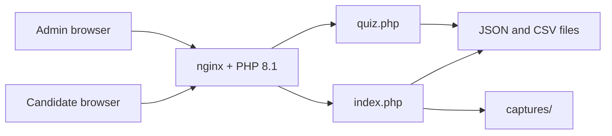

# Skylab HR

Internal quiz portal for Fusion. Candidates open a category list, sit a timed multiple-choice exam, and admins review scores, answer keys, and webcam captures. The app is plain PHP on nginx. It does not use a database.

Production: [https://skylab.fusion.co.th/hr/](https://skylab.fusion.co.th/hr/)

| Page | Role |
| --- | --- |
| `index.php` | Portal. Categories, webcam capture, capture admin. |
| `quiz.php` | Exam engine. CSV quizzes, timing, results, quiz admin. |
| `quiz2.php` | Older exam page kept as a backup. It is not the live exam. |
| `test_email.php` | Mail smoke test. Not part of a normal deploy. |

`index.php` and `quiz.php` share one PHP session (`PHPSESSID`, cookie path `/`). An admin who signs in on either page is signed in on the other.

## Architecture



The web root on the server is `/var/www/html/hr`. PHP writes state next to the scripts. There is no migration step and no background worker.

| File | Written by | What it stores |
| --- | --- | --- |
| `quiz_data.json` | `index.php` | Portal categories and the URL each button opens. |
| `quiz_mapping.csv` | `quiz.php` | Exam list: title, CSV name, question count, pass mark, duration, show-answers flag. |
| `quizzes/*.csv` | Admin upload or editor | Question banks. |
| `quiz_results.json` | `quiz.php` | Finished attempts, including answers and the question set that was served. |
| `captures/*.png` | `index.php` | Webcam frames. |
| `tmp/quiz_backups/` | `quiz.php` | A copy of a quiz CSV before an edit or replace. |
| `/var/log/nginx/quiz.log` | Both apps | Application log. If that path is not writable, the apps append to `quiz_local.log` in the web root. |

Deploy scripts upload only `index.php` and `quiz.php`. They do not upload the files in the table above, so a deploy cannot wipe production quizzes, results, portal links, or photos.

## Portal

`index.php` is the page candidates see first when they use the category launcher.

1. A privacy notice is shown until the browser stores consent in `sessionStorage`.
2. Categories and quiz buttons are rendered from `quiz_data.json`.
3. The page asks for the webcam. A quiz button does not start until the camera is available.
4. Choosing a quiz captures one PNG (`type=start`), then opens the link. Links marked external (currently Preply) open in a new tab. Other links load in an iframe on the same page.
5. While that quiz is active, the page samples the camera every 5 seconds.

The camera check is average brightness, not face recognition. Brightness below 30 or above 250 for more than three checks saves another PNG (`type=cheating_suspected`) and shows a warning. The camera runs only while the portal tab stays open. Opening `quiz.php` directly does not take photos.

Capture files are named `{userId}_{type}_{Y-m-d_H-i-s}.png`. `userId` is generated in the browser as `user_` plus the current time. It is not the candidate name from `quiz.php`.

Admins can reorder categories, edit links, and review captures. The capture panel shows total storage in MB and can load, select, or delete PNG and JPEG files only.

## Exam

`quiz.php` runs the CSV exams.

1. Privacy notice, Thai by default, with TH and EN. Accepting it sets `pdpa_accepted` in the PHP session.
2. The candidate enters a name and email.
3. They pick a quiz. A briefing dialog shows the format, question count, and total time, in Thai or English. The timer starts only after OK. Back does not start the exam.
4. One question is shown at a time. The candidate can move next and previous. A single countdown covers the whole exam. When time runs out, the attempt is submitted.
5. The result page shows pass or fail, score, and time spent. The full answer key is shown only when that quiz has **แสดงเฉลย** turned on.

Each attempt stores the questions that were actually served, the chosen option for each, score, pass mark, duration, timeout flag, client IP, and how many times the page was left. Older rows may not have IP or leave count; the report shows those as `-`.

### Question selection

`quiz_mapping.csv` sets how many questions to load. The engine shuffles the bank and takes that many. The default pass mark for a new quiz is 70%. The default duration is one minute per loaded question. Admins can override both.

### Leaving the exam

After the exam page has loaded and the window has been focused, hiding the tab, blurring the window, or leaving fullscreen increments one counter. The warning says the candidate is not allowed to leave the exam and shows the count. Escape does not dismiss that dialog, because Escape also exits fullscreen. A **เต็มจอ** button can enter fullscreen; leaving fullscreen counts the same as switching away. The count is submitted with the attempt and shown in the admin report as **Left Page**.

The browser cannot stop someone from switching apps. The counter is stored in the page and posted with the form, so it is a record of what the page observed, not a sealed audit log.

Copy, cut, select-all, and the context menu are blocked on the exam form. The admin question editor is not blocked. None of this stops a screenshot.

### Answer key setting

**Upload New Quiz** and each row of **Available Quizzes** have **แสดงเฉลย**. Existing quizzes stay on until an admin turns the box off and clicks **Save** for that row. When it is off, the candidate still sees pass or fail, score, and time, plus the line that answers are hidden. Admin **เฉลย** and **Show Answer Key** still show the key.

The choice is stored as `Show Answers` (`1` or `0`) in `quiz_mapping.csv`. Rows written before that column existed are treated as on.

## Admin

Both pages use the same admin password. It is set in `index.php` (`ADMIN_PASSWORD`) and `quiz.php` (`$ADMIN_PASSWORD`). Change both and deploy both files. Do not put the password in this document, a ticket, or a chat log.

Quiz admin can:

- Upload a CSV, replace a CSV, or edit questions in the browser.
- Reorder quizzes with **Move Up**. The first row reports that it is already at the top.
- Download a quiz CSV. The download is sent with a UTF-8 BOM so Excel shows Thai text. The BOM is added at download time and is not written back into `quizzes/`.
- Copy one question, or all questions, from the editor to check wording. The copy marks the correct option.
- Open the results report, open an attempt's answer key, and delete an attempt.

The portal admin can add, edit, delete, and reorder categories and links, and manage captures.

Signing out of the quiz admin clears the shared admin session. A candidate logout on `quiz.php` destroys the whole session, including an admin who was using the same browser.

## CSV formats

Question bank:

```csv
question,option1,option2,option3,option4,correct_index
"What is 2 + 2?",3,4,5,22,1
```

`correct_index` is `0` through `3`. Every row needs a question and four non-empty options. Uploads and the editor reject anything else.

Quiz list, as rewritten by the admin save:

```csv
Quiz Title,CSV Filename,Questions to Load,Passing Score (%),Duration (minutes),Show Answers
Linux Essential,Linux_Essential_1765100611.csv,10,70,10,1
```

Downloaded question banks are UTF-8. Keep the source files UTF-8 without a BOM. A BOM stored in the file can be read as part of the first header by PHP.

## Deploy

The server is `ubuntu@skylab.fusion.co.th`. The app directory is `/var/www/html/hr`. Both scripts take the SSH private key as a required argument, upload `index.php` and `quiz.php`, then run `php -l` on the server for those two files.

Mac:

```bash
./deploy-mac.sh /path/to/key.pem
```

The Mac script sets the key file mode to `600` and uploads with `rsync`.

Windows, from Git Bash:

```bash
bash deploy-windows.sh C:/path/to/key.pem
```

A backslash path works as well: `bash deploy-windows.sh 'C:\path\to\key.pem'`. OpenSSH on Windows rejects a key that other users can read, so the script removes inherited permissions and grants read to the current Windows user. If `rsync` is installed it is used; otherwise the script uses `scp`.

Do not rsync these paths over production:

- `quizzes/`
- `quiz_mapping.csv`
- `quiz_data.json`
- `quiz_results.json`
- `captures/`

Upload a new exam from **Admin Panel** on `quiz.php`, or copy a single CSV into `quizzes/` and add a mapping row on the server. Replacing `quiz_mapping.csv` from a laptop rewrites the live exam order, pass marks, durations, and answer-key flags.

`quiz2.php`, `vendor/`, and `test_email.php` are not in the deploy set. `vendor/` is PHPMailer, required only by the backup exam page and the mail smoke test.

## Runtime

Production uses nginx and PHP 8.1. The app needs a writable `quizzes/` directory, writable `quiz_results.json`, `quiz_data.json`, and `quiz_mapping.csv`, and a writable `captures/` directory. Sessions use the default PHP file session handler.

Logs go to `/var/log/nginx/quiz.log`. The client IP stored on an attempt is `REMOTE_ADDR`. `X-Forwarded-For` is used only when that address is a private or reserved proxy address. On this host, `/hr` is not behind the banking proxy, so the stored IP is the candidate's address.

To run a copy locally, point any PHP 8.1 server at this directory and open `index.php` or `quiz.php`. Create the data files by using the admin screens, or keep the copies already in the tree. Local results and portal data are not the production copies.

## Repository layout

```text
index.php            Portal and webcam proctoring
quiz.php             Live exam and quiz admin
quiz2.php            Previous exam implementation
test_email.php       PHPMailer smoke test
deploy-mac.sh        Deploy the two live pages from macOS
deploy-windows.sh    Deploy the two live pages from Git Bash
quiz_mapping.csv     Exam catalog checked into git as a sample
quiz_data.json       Portal catalog checked into git as a sample
quizzes/             Question banks
vendor/              PHPMailer
```

`quiz_results.json` in git is not the production result set. Production results stay on the server.

## Operational notes

- Keep this repository private. It contains exam content and the admin password in source.
- After changing the admin password, deploy both `index.php` and `quiz.php`. The two constants are independent.
- Direct requests for `quizzes/*.csv`, `quiz_results.json`, and `quiz_mapping.csv` are not blocked by PHP. Restrict those paths in nginx if the host is reachable beyond the office network.
- Question-bank edits keep a timestamped copy under `tmp/quiz_backups/` before the CSV is replaced.
- The exam page tells candidates that photographs are collected. The photographs are taken by `index.php` when the candidate starts from the portal, not by `quiz.php` itself.
